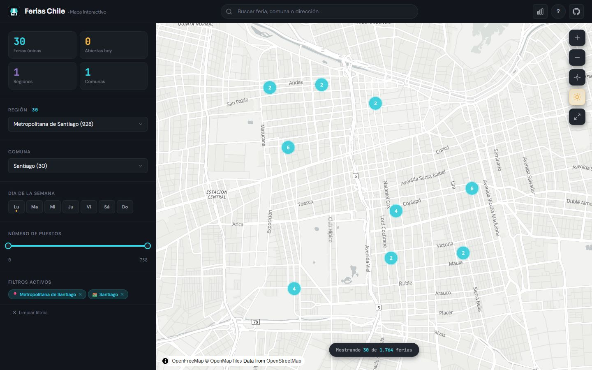
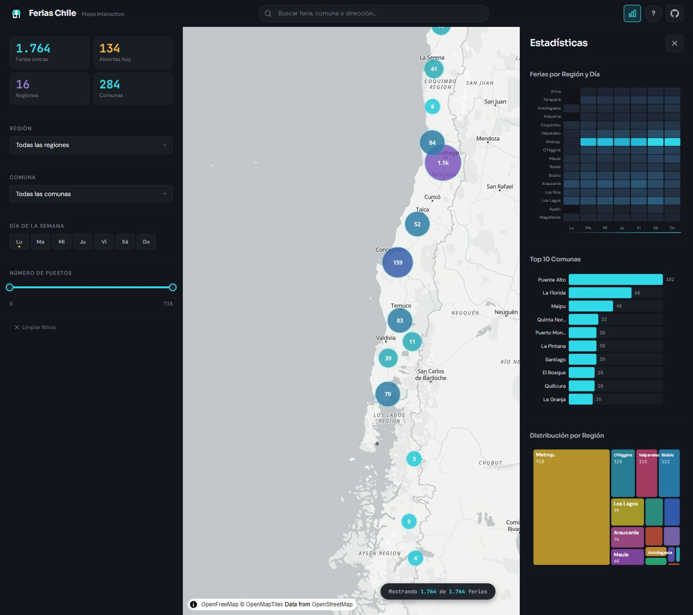
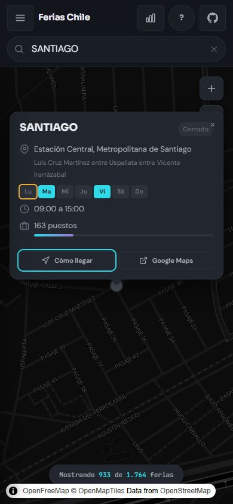

<p align="center">
  
</p>

<h1 align="center">Ferias Libres de Chile</h1>

<p align="center">
  <strong>Tu próxima feria, en el mapa.</strong><br>
  Explora tu comuna, elige un día y encuentra dónde ir a comprar.
</p>

<p align="center">
  <a href="https://geoidegeoidal.github.io/ferias-chile/"><strong>Abrir el mapa →</strong></a>
  · <a href="#ejecutar-en-local">Ejecutar en local</a>
  · <a href="#actualizar-los-datos">Datos y fuentes</a>
</p>

<p align="center">
  <strong>1.764 ferias</strong> · <strong>284 comunas</strong> · <strong>16 regiones</strong><br>
  <sub>Cobertura del conjunto de datos incluido, a partir de información publicada por ODEPA.</sub>
</p>

<a href="https://geoidegeoidal.github.io/ferias-chile/">
  <picture>
    <source media="(prefers-color-scheme: dark)" srcset="assets/readme/mapa-oscuro.jpg">
    
  </picture>
</a>

<p align="center"><sub>Captura real del visor en Santiago. La portada acompaña el tema claro u oscuro de tu sistema.</sub></p>

## Del barrio al puesto

Elige una región y una comuna, combina los filtros y abre una feria para consultar su dirección, días y horario. Puedes pasar de una vista de todo Chile al detalle de una calle, o buscar directamente por nombre o dirección.

<table>
  <tr>
    <td width="65%" valign="top">
      <h3>Una mirada al país</h3>
      <a href="assets/readme/estadisticas.jpg"></a>
      <p>Compara la actividad de las 16 regiones, revisa los días con más ferias y explora el ranking de comunas. Los gráficos también sirven para filtrar el mapa.</p>
      <p><strong>Dos formas de recorrerlo:</strong> mapa oscuro para destacar los puntos y mapa claro para leer el entorno. Al cambiar de estilo se conservan los filtros.</p>
      <p><a href="assets/readme/mapa-oscuro.jpg">Ver mapa oscuro</a> · <a href="assets/readme/mapa-claro.jpg">Ver mapa claro</a></p>
    </td>
    <td width="35%" valign="top">
      <h3>La feria, en el bolsillo</h3>
      <a href="assets/readme/vista-movil.jpg"></a>
      <p>Consulta la ficha desde el celular y abre las indicaciones para llegar en Google Maps.</p>
    </td>
  </tr>
</table>

## Qué permite hacer

- Explorar ferias agrupadas en el mapa y consultar dirección, días, horario y puestos.
- Combinar filtros por región, comuna, día de la semana y tamaño de feria.
- Buscar ferias y comunas; buscar direcciones mediante Nominatim.
- Encontrar ferias cercanas usando la ubicación del navegador y abrir indicaciones en Google Maps.
- Consultar gráficos por región y día, ranking de comunas y distribución regional.
- Alternar mapas claros y oscuros manteniendo los filtros y la ubicación.
- Instalar el visor como PWA y reutilizar recursos previamente almacenados sin conexión.

**“Abiertas hoy” significa que la feria tiene programado funcionar ese día de la semana.** No verifica apertura en este momento, feriados, suspensiones ni cambios posteriores al catastro. Los datos son una copia estática; el visor no consulta ODEPA en tiempo real.

## Ejecutar en local

Requiere **Node.js 20 o superior** y npm. Los datos del visor ya están incluidos: no necesitas instalar Python para usar el mapa.

```sh
git clone https://github.com/geoidegeoidal/ferias-chile.git
cd ferias-chile/web
npm ci
npm run dev
```

Abre [http://localhost:3000/ferias-chile/](http://localhost:3000/ferias-chile/). Si el puerto está ocupado, Vite informa el puerto alternativo en la terminal.

## Pruebas y compilación

Desde `web/`:

```sh
npm test
npm run build
npm run preview
```

- `npm test` ejecuta regresiones con el runner de Node: conservación de capas al cambiar el mapa, control de puestos con teclado, accesibilidad de paneles, recuperación de errores y búsqueda sin respuestas obsoletas. No necesita un proveedor cartográfico ni un GPS real. Node puede mostrar un aviso sobre sus módulos VM experimentales.
- `npm run build` genera el sitio en `docs/`, una carpeta ignorada por Git.
- `npm run preview` sirve esa compilación; usa la dirección indicada en la terminal.

Para validar visualmente, comprueba ambos temas, los filtros combinados, la búsqueda, las estadísticas y la navegación con Tab y Escape. En móvil, verifica el buscador y la apertura/cierre de filtros. Las pruebas de módulos no sustituyen estas comprobaciones en navegador.

## Mapa base y servicios externos

El mapa usa **MapLibre GL JS** y los estilos vectoriales de [OpenFreeMap](https://openfreemap.org/):

| Tema | Estilo |
| --- | --- |
| Oscuro | `https://tiles.openfreemap.org/styles/dark` |
| Claro | `https://tiles.openfreemap.org/styles/positron` |

Los estilos conservan una apariencia cercana a Dark Matter y Positron. No necesitan cuenta ni clave API. La atribución de OpenMapTiles y OpenStreetMap se muestra en el mapa. La configuración está en `web/js/map.js`; la política de recursos externos está en `web/index.html`.

La búsqueda de direcciones depende de [Nominatim](https://nominatim.org/). Los resultados de ferias locales aparecen sin esperar su respuesta. La geolocalización requiere permiso del usuario y un contexto seguro: HTTPS o localhost.

El mapa base, la búsqueda de direcciones y las fuentes web dependen de servicios externos. OpenFreeMap no ofrece una garantía de disponibilidad para su instancia pública.

## PWA y modo offline

El service worker **solo se registra en producción**, para evitar que una caché antigua interfiera con el desarrollo. Usa `npm run build` y `npm run preview` para probar su comportamiento.

Se almacenan la página, los recursos cargados, los datos y hasta 500 recursos cartográficos. El modo offline permite consultar contenido ya visitado; **no descarga todo Chile ni garantiza nuevas zonas o niveles de zoom sin conexión**. La búsqueda de direcciones necesita red.

Cuando cambies el app shell o el proveedor cartográfico, actualiza las versiones correspondientes en `web/public/sw.js`. Para comprobar una actualización de PWA, recarga después de que se active el nuevo service worker.

## Estructura

```text
ferias-chile/
├── assets/readme/              # Capturas reales para esta documentación
├── data/                       # Datos normalizados y fuentes descargadas
├── scripts/                    # Extracción, normalización y generación del visor
├── web/
│   ├── index.html              # Página, SEO, favicon y política CSP
│   ├── js/                     # Mapa, datos, filtros, búsqueda, gráficos y tour
│   ├── css/                    # Diseño y comportamiento responsive
│   ├── public/
│   │   ├── data/               # GeoJSON y estadísticas usados por el sitio
│   │   ├── icons/              # Favicon SVG/PNG e iconos PWA
│   │   ├── manifest.json
│   │   └── sw.js
│   ├── tests/                  # Pruebas de regresión
│   └── vite.config.js
└── .github/workflows/deploy.yml # Compilación y publicación en GitHub Pages
```

El favicon tiene como fuente editable `web/public/icons/favicon.svg`: un puesto de feria en la paleta del visor. Se incluye PNG de 32 px, iconos PWA de 192/512 px y una variante maskable con margen de seguridad.

## Actualizar los datos

El frontend funciona con los JSON versionados. Para volver a obtener datos, necesitas Python y las dependencias de `requirements.txt`. Desde la raíz del repositorio:

```sh
python -m pip install -r requirements.txt
python -X utf8 scripts/odepa_dspace.py
python -X utf8 scripts/normalize.py
python -X utf8 scripts/build_web_data.py
```

El último comando escribe `ferias.json` y `stats.json` en **`web/public/data/`**, que Vite copia al sitio compilado. Revisa conteos, coordenadas y cambios de esquema antes de publicar; después vuelve a ejecutar las pruebas y la compilación.

La fuente principal es `Ferias_Pais_PowerBI.xlsx` de la [Biblioteca Digital de ODEPA](https://bibliotecadigital.odepa.gob.cl/). Los scripts de Sercotec y PowerBI son exploratorios y no forman parte del flujo necesario para ejecutar el visor.

## Publicar

GitHub Actions instala dependencias con `npm ci`, ejecuta las pruebas, compila `web/` y publica `docs/` cuando recibe un push a `master` o se ejecuta manualmente. En GitHub Pages, selecciona **GitHub Actions** como origen.

La ruta pública es `/ferias-chile/`. Si cambias el nombre o la ruta del sitio, revisa `web/vite.config.js`, las rutas del manifest y service worker, y las URL públicas de `web/index.html`.

## Stack y fuentes

Vite 6, JavaScript sin framework, MapLibre GL JS 4.7, D3.js 7 y CSS con propiedades personalizadas. El pipeline usa Python, pandas y openpyxl.

Los datos proceden de ODEPA y deben usarse respetando sus términos y atribución. La cartografía utiliza datos de OpenStreetMap bajo sus condiciones. Este repositorio no incluye actualmente un archivo `LICENSE` para el código; no se presupone una licencia MIT.
